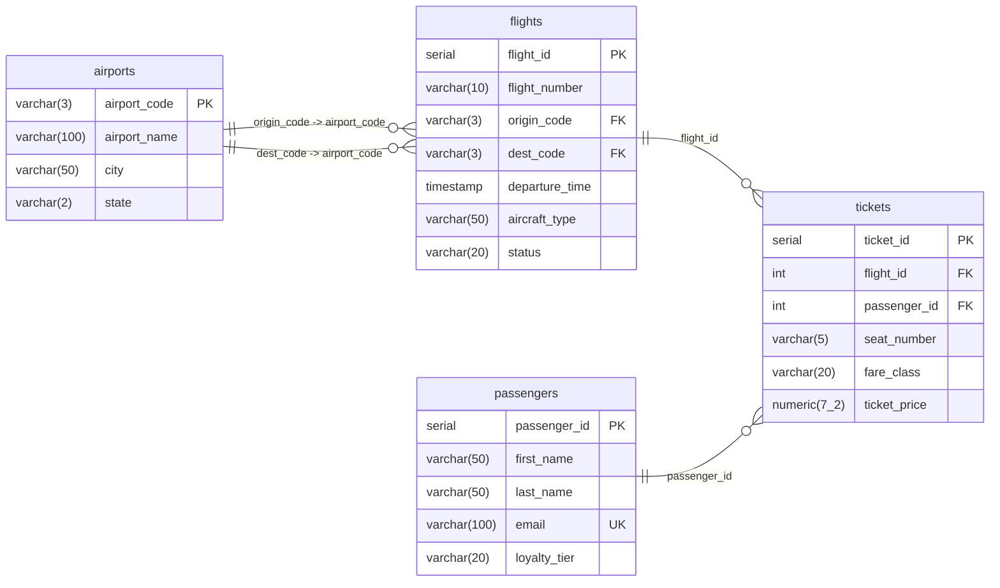

# Exam 2 Data Dictionary: Regional Airline Management

**Course:** COS 313: Database Systems (Fall 2026, Bethel University)  
**Database:** `sports_db`  
**Context:** You are a database engineer for SkyWings Regional Airlines. This document details the schema, column definitions, data types, relational keys, and entity relationships for the tables pre-populated in your exam environment.

---

## Relational Entity-Relationship Diagram (ERD)

---

## Pre-Populated Airline Tables

### Table: `airports`
A core reference lookup table containing commercial airports serviced by SkyWings Regional Airlines.  
* **Baseline Row Count:** 50 records  
* **Primary Key:** `airport_code`  

| Column Name | Data Type | Constraint / Key | Description |
| :--- | :--- | :--- | :--- |
| `airport_code` | `VARCHAR(3)` | **PRIMARY KEY** | 3-letter IATA airport code (e.g., `'MSP'`, `'ORD'`, `'DFW'`). |
| `airport_name` | `VARCHAR(100)` | `NOT NULL` | Full official name of the airport facility. |
| `city` | `VARCHAR(50)` | `NOT NULL` | Municipality where the airport is located. |
| `state` | `VARCHAR(2)` | `NOT NULL` | 2-letter US postal state abbreviation. |

---

### Table: `passengers`
Stores biographical, contact, and frequent-flyer loyalty program information for all airline customers.  
* **Baseline Row Count:** 4,000 records  
* **Primary Key:** `passenger_id`  

| Column Name | Data Type | Constraint / Key | Description |
| :--- | :--- | :--- | :--- |
| `passenger_id` | `SERIAL (INT)` | **PRIMARY KEY** | Auto-incrementing unique surrogate identifier for each passenger. |
| `first_name` | `VARCHAR(50)` | `NOT NULL` | Passenger legal first name. |
| `last_name` | `VARCHAR(50)` | `NOT NULL` | Passenger legal last name. |
| `email` | `VARCHAR(100)` | `NOT NULL, UNIQUE` | Unique personal email address used for reservations. |
| `loyalty_tier` | `VARCHAR(20)` | `NOT NULL` | Frequent flyer status tier (`'Standard'`, `'Silver'`, `'Gold'`, `'Platinum'`). |

---

### Table: `flights`
Schedules and flight routing metadata connecting origin and destination airports.  
* **Baseline Row Count:** 250 records  
* **Primary Key:** `flight_id`  
* **Foreign Keys:**  
  * `origin_code` references `airports(airport_code)` (Departure airport)  
  * `dest_code` references `airports(airport_code)` (Arrival airport)  

| Column Name | Data Type | Constraint / Key | Description |
| :--- | :--- | :--- | :--- |
| `flight_id` | `SERIAL (INT)` | **PRIMARY KEY** | Auto-incrementing unique identifier for each scheduled flight leg. |
| `flight_number` | `VARCHAR(10)` | `NOT NULL` | Commercial flight callsign (e.g., `'SW204'`, `'DL101'`). |
| `origin_code` | `VARCHAR(3)` | `NOT NULL, FOREIGN KEY` | References `airports(airport_code)`. Departure airport. |
| `dest_code` | `VARCHAR(3)` | `NOT NULL, FOREIGN KEY` | References `airports(airport_code)`. Arrival airport. |
| `departure_time`| `TIMESTAMP` | `NOT NULL` | Scheduled date and time of departure. |
| `aircraft_type` | `VARCHAR(50)` | `NOT NULL` | Make and model of aircraft assigned (e.g., `'Boeing 737-800'`). |
| `status` | `VARCHAR(20)` | `NOT NULL` | Flight status (`'Scheduled'`, `'On Time'`, `'Delayed'`, `'Departed'`, `'Arrived'`, `'Cancelled'`). |

---

### Table: `tickets`
High-volume transactional ledger recording individual passenger ticket bookings and seat assignments across flights.  
* **Baseline Row Count:** 45,000 records  
* **Primary Key:** `ticket_id`  
* **Foreign Keys:**  
  * `flight_id` references `flights(flight_id)` (The specific flight booked)  
  * `passenger_id` references `passengers(passenger_id)` (The passenger traveling)  

| Column Name | Data Type | Constraint / Key | Description |
| :--- | :--- | :--- | :--- |
| `ticket_id` | `SERIAL (INT)` | **PRIMARY KEY** | Auto-incrementing unique surrogate key for each ticket transaction. |
| `flight_id` | `INT` | `NOT NULL, FOREIGN KEY` | References `flights(flight_id)`. The specific flight booked. |
| `passenger_id` | `INT` | `NOT NULL, FOREIGN KEY` | References `passengers(passenger_id)`. The passenger traveling. |
| `seat_number` | `VARCHAR(5)` | `NOT NULL` | Assigned cabin seat (e.g., `'12A'`, `'16C'`). |
| `fare_class` | `VARCHAR(20)` | `NOT NULL` | Booking cabin class (`'Economy'`, `'Premium Economy'`, `'Business'`, `'First'`). |
| `ticket_price` | `NUMERIC(7,2)` | `NOT NULL` | Base fare paid in US dollars (e.g., `249.50`). |
